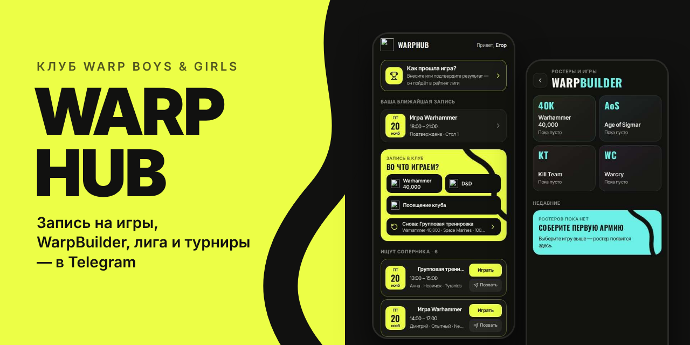
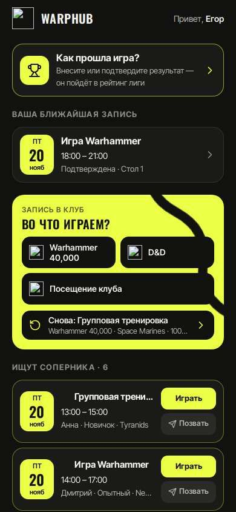
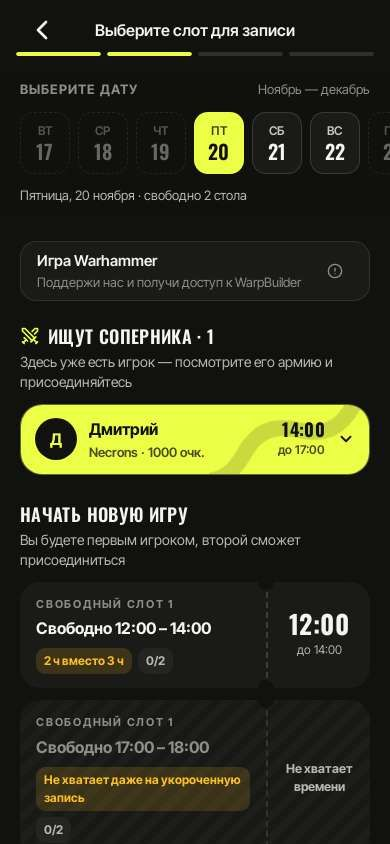
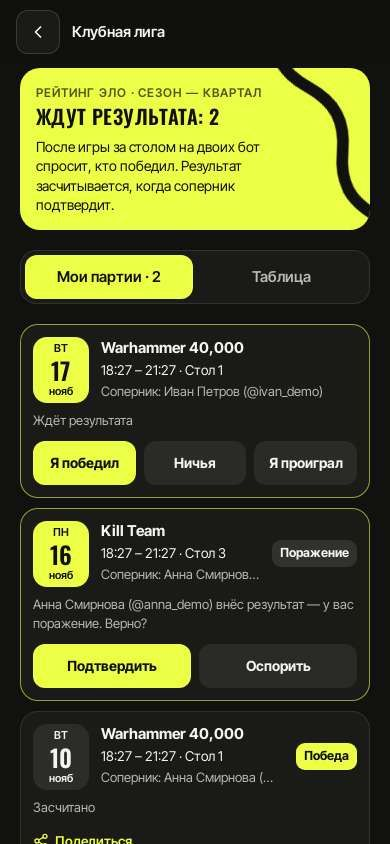
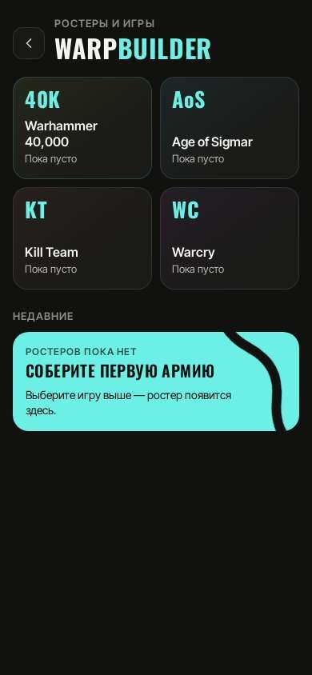

<p align="center"></p>

# WarpHub

Telegram Mini App клуба настольных игр **Warp Boys & Girls** — [@WarpHubBot](https://t.me/WarpHubBot).

<p>
  
  
  
  
</p>

## Что умеет

- **Запись в клуб** — игры за столами (Warhammer 40,000, Age of Sigmar, Kill Team, Warcry), тренировки, покраска,
  посещение клуба, D&D; поиск соперника, лист ожидания, автоподтверждение.
- **WarpBuilder** — ростеры и карточки отрядов для 40K, AoS, Kill Team и Warcry, режим игры вдвоём, тесты-армии,
  обучение правилам. Открывается по коду или подписчикам Boosty.
- **Лига и турниры** — рейтинг Эло по сезонам, швейцарская система, подтверждение результатов обоими игроками.
- **Мини-игры, награды, новости, ивенты**; уведомления бота карточками в стиле клуба.
- **Админка** — записи, столы, цены, контент, уведомления, кураторы направлений.

## Как устроено

| Папка | Что это |
|---|---|
| [`client/`](client) | Mini App: Vite + React + TypeScript + Tailwind |
| [`backend/`](backend) | API: Bun + Elysia + Drizzle ORM, PostgreSQL, MinIO (S3), уведомления бота |
| [`backend/roster-data/`](backend/roster-data) | данные WarpBuilder (собираются в `tools/roster-data`) |
| [`tools/roster-data/`](tools/roster-data) | импорт и проверка данных ростеров, тесты движков — [README](tools/roster-data/README.md) |
| [`tools/roster-demo/`](tools/roster-demo) | демо-сервер без Telegram и базы: весь интерфейс на фейковом API |
| [`tools/ui-shots/`](tools/ui-shots) | скриншоты демо-сборки в CI (метки `ui-shots`, `ui-audit`) |
| [`tools/design/`](tools/design) | генераторы рамок, плакатов, промо |
| [`ops/`](ops) | скрипты сервера: проверка и деплой — [README](ops/README.md) |
| [`docs/`](docs) | [дизайн-код](docs/design-code.md), [дизайн-система WarpBuilder](docs/warpbuilder-design-system.md) |

## Запуск локально

Нужен [Bun](https://bun.sh) 1.3+.

```bash
# демо без Telegram и базы данных (весь интерфейс на фейковом API)
cd client && bun install && bun run build:demo && cd ..
node tools/roster-demo/server.mjs          # http://localhost:5050

# backend (нужны PostgreSQL и MinIO; переменные — backend/.env.example)
cd backend && bun install && cp .env.example .env && bun run dev

# client (переменные — client/example.env)
cd client && bun install && cp example.env .env && bun run dev
```

Проверки — те же, что в CI:

```bash
cd backend && bun test tests                                   # unit (e2e — в CI с временной PostgreSQL)
cd client && bunx tsc -p tsconfig.app.json --noEmit && bun run lint && bun run build
cd tools/roster-data && bun test tests/
```

## Как вносятся изменения

- `main` — то, что работает в проде. Работа — в коротких ветках и pull request в `main`
  (данные WarpBuilder — через `roster-builder`, см. [CLAUDE.md](CLAUDE.md)).
- CI на каждый PR: backend (unit + e2e), client (типы, lint, сборка), данные ростеров; скриншоты — по меткам.
- Деплой — вручную: Actions → **Deploy** (dry-run → apply), отчёты в issue «Deploys».
  Без GitHub Actions — `ops/manual/build-package.sh` на сервере. Подробно — [ops/README.md](ops/README.md).
- Секреты (`.env`) в репозиторий не попадают.

## Права и источники данных

Репозиторий открыт для просмотра, но **не является open source**: лицензии на код нет — все права на код WarpHub
принадлежат его владельцу; копирование и использование без разрешения не допускаются.

Игровые данные WarpBuilder взяты из сторонних источников и принадлежат их правообладателям; они хранятся здесь
только для работы приложения клуба (некоммерческое использование):

- Warhammer 40,000, Age of Sigmar, Kill Team, Warcry — товарные знаки Games Workshop Ltd. Проект не связан с
  Games Workshop и не одобрен ею.
- Тексты и данные правил: wh-rules.ru, Wahapedia, BSData / sigdex.io, warmind.online, ktdash (ktdash-v4-public),
  krisling049/warcry_data, warcrier.net; данные 40kdc — по лицензии CC BY 4.0 (`tools/roster-data/vendor/`).
- Карты Kill Team и Warcry (`client/public/roster-maps/`) — материалы Games Workshop.

Правообладатель, который хочет удалить свои материалы, может написать владельцу репозитория — материалы будут удалены.
